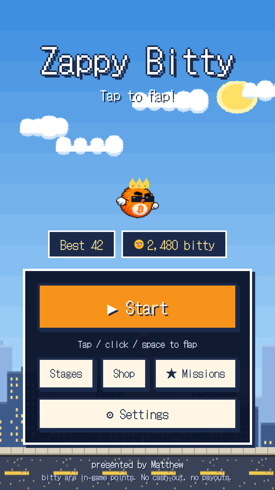
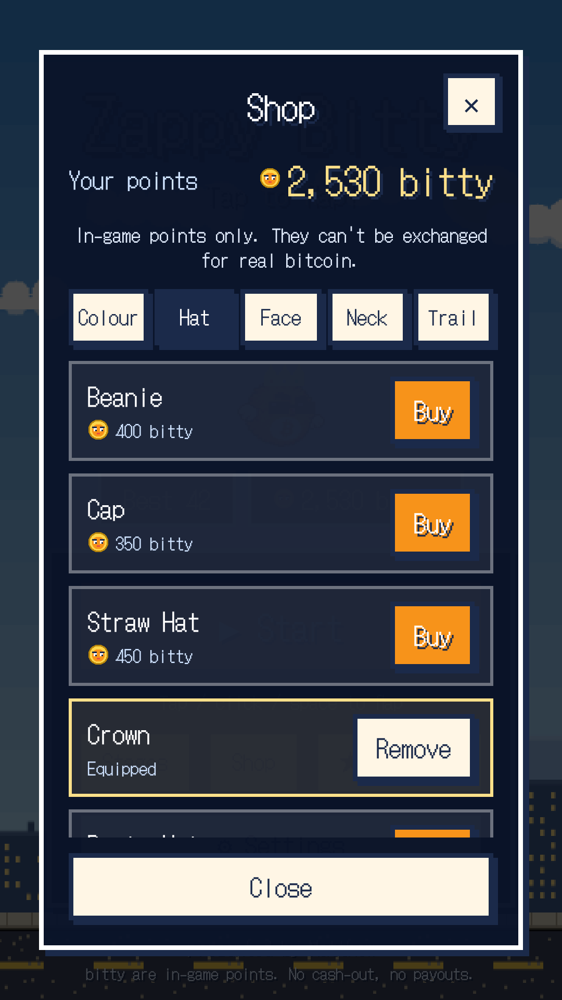
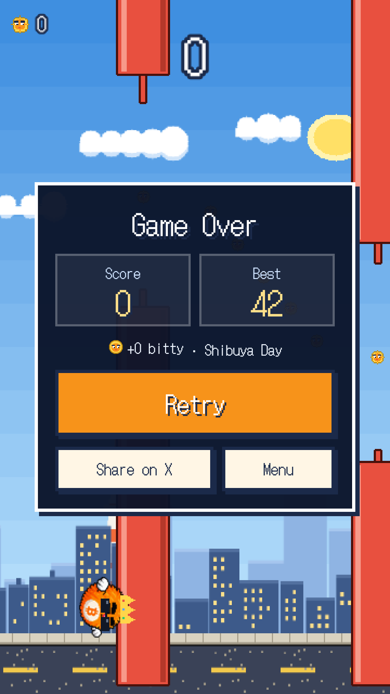

# Zappy Bitty

**日本語** | [English](README.en.md)

bitty くんがローソク足チャートをくぐり抜ける、ワンタップのゲームです。オープンソース（MIT ライセンス）で、スマホの中だけで動きます。

- アカウントなし、サーバーなし、広告なし、データの送信なし
- オフラインで遊べます
- 記録・bitty・装備は端末の中（WebView の localStorage）にだけ保存されます
- 日本語 / English

<p>
  
  
  
  
</p>

## 遊び方

- タップで羽ばたき、チャートのすき間をくぐると 1 点。ぶつかったらゲームオーバー
- 渋谷から銀河の果てまで 14 のゾーン。ゾーンごとに景色・BGM・障害物が変わります
- コインを集めると、ゲーム内ポイント **bitty** が貯まります。ショップの着せ替え（色・帽子・顔・首・軌跡）や、1 プレイ 1 回のコンティニュー（21 bitty）に使えます
- 実績（ミッション）を達成すると bitty がもらえます

bitty はゲーム内のポイントで、本物のビットコインではありません。

## 開発

Node.js 22 以上が必要です。

```bash
npm install
npm run dev        # http://localhost:5173 でブラウザから遊べます
npm run lint       # ESLint
npm run typecheck  # tsc --noEmit
npm test           # Vitest（難易度・経済・実績・翻訳などの純粋ロジック）
npm run build      # dist/ に静的ファイルを出力
```

| 用途 | 採用 |
| --- | --- |
| ゲーム描画 | [Phaser 3](https://phaser.io/)（Arcade Physics） |
| UI | React 19 + zustand |
| ビルド | Vite |
| Android アプリ化 | [Capacitor](https://capacitorjs.com/)（`dist/` を APK に同梱） |
| 効果音・BGM | Web Audio API で実行時に合成（音声素材なし） |
| 背景・障害物 | Phaser の Graphics で起動時に生成（画像素材なし） |

主なファイル:

- `src/game/` ゲーム本体（シーン、障害物、ゾーン、難易度、BGM / 効果音）
- `src/components/` React の画面（スタート、ゲームオーバー、ショップ、設定など）
- `src/config/` 調整用の設定（`game.ts` 名前やリンク、`economy.ts` アイテムと値段、`achievements.ts` 実績）
- `src/i18n/translations.ts` 日本語と英語の文言
- `android/` Capacitor の Android プロジェクト
- `art/bitty.png` bitty くんの元絵。`npm run assets:sprite` でゲーム用スプライト、`npm run assets:icons` でアプリアイコンと起動画面を作り直します

### 応援ボタン

`src/config/game.ts` の `lightningAddress` に Lightning アドレスを書くと、設定に「♥ 応援する」が出ます。押すとプレイヤーのウォレットアプリが `lightning:` リンクで開くだけで、ゲーム自体は支払いに関わりません。空のままならボタンは出ません。

## Android アプリのビルド

Android Studio（または Android SDK）と JDK 21 が必要です。

```bash
npm run android:sync          # Web 版をビルドして android/ にコピー
cd android && ./gradlew assembleDebug
# → android/app/build/outputs/apk/debug/app-debug.apk
```

`npx cap open android` で Android Studio から実機・エミュレーターで動かすこともできます。

バージョンは `package.json` の `version` で決まります（`1.2.3` → versionName `1.2.3`、versionCode `10203`）。

## リリースと Zapstore での配布

### 最初に 1 回だけ

1. **署名鍵（keystore）を作る。** なくすとアプリを更新できなくなるので、必ずバックアップしてください。リポジトリには絶対に入れないでください。

   ```bash
   keytool -genkeypair -v -keystore zappybitty-release.jks -alias zappybitty \
     -keyalg RSA -keysize 4096 -validity 10000
   ```

2. **GitHub の Secrets に登録する**（Settings → Secrets and variables → Actions）。

   | 名前 | 値 |
   | --- | --- |
   | `ANDROID_KEYSTORE_BASE64` | `base64 -w0 zappybitty-release.jks` の出力 |
   | `ANDROID_KEYSTORE_PASSWORD` | keystore のパスワード |
   | `ANDROID_KEY_ALIAS` | `zappybitty` |
   | `ANDROID_KEY_PASSWORD` | 鍵のパスワード（keystore と同じにした場合は同じ値） |

3. **zsp（Zapstore の公開ツール）を入れる。**

   ```bash
   go install github.com/zapstore/zsp/cmd/zsp@latest
   ```

### リリースのたびに

1. `package.json` の `version` を上げ、`CHANGELOG.md` にそのバージョンの節（`## [1.0.1]`）を足してコミットする
2. タグを push する: `git tag v1.0.1 && git push origin v1.0.1`
3. GitHub Actions（`.github/workflows/release.yml`）が署名済み APK `zappybitty-1.0.1.apk` を作り、GitHub Release に添付します
4. リポジトリのフォルダで Zapstore に公開する
   - **初回:** `zsp` を引数なしで実行（ウィザード）。APK があなたの署名鍵で署名されていることと、あなたの Nostr 鍵の持ち主であることを証明し、最初のリリースと一緒に公開します。keystore のパスワードや nsec はウィザードの中で入力し、他人や AI には渡さないでください
   - **2 回目以降:** `SIGN_WITH=<nsec1… または bunker://…> zsp publish`

`zapstore.yaml` にストアの掲載情報（名前、説明、アイコン、スクリーンショット）があります。zsp は GitHub Release から最新の APK を取ってきます。

## ライセンス

コード、bitty くんのイラスト、その他の素材はすべて [MIT ライセンス](LICENSE) です。

使っているもの:

| 名称 | ライセンス |
| --- | --- |
| [DotGothic16](https://github.com/fontworks-fonts/DotGothic16)（Fontworks / The DotGothic16 Project Authors） | SIL Open Font License 1.1（[`src/assets/fonts/DotGothic16-OFL.txt`](src/assets/fonts/DotGothic16-OFL.txt)） |
| [Phaser](https://github.com/phaserjs/phaser) | MIT |
| [React](https://github.com/facebook/react) | MIT |
| [zustand](https://github.com/pmndrs/zustand) | MIT |
| [Capacitor](https://github.com/ionic-team/capacitor) | MIT |
